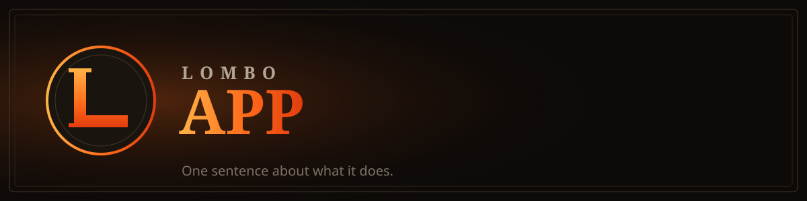

<p align="center"></p>

<p align="center">
  <a href="LICENSE"></a>
  <a href="https://github.com/Lombo-Forge/lombo-jellyfin-template/actions/workflows/ci.yml"></a>
  <a href="https://github.com/Lombo-Forge/lombo-jellyfin-template/actions/workflows/codeql.yml"></a>
  <a href="https://github.com/Lombo-Forge/lombo-jellyfin-template/releases"></a>
  
  <!-- template:begin -->
  <a href="https://ko-fi.com/datlombardo"></a>
  <!-- template:end -->
</p>

# Lombo Jellyfin Template

A starting point for a small app that sits next to your Jellyfin server and does one job: watches something, decides, and tells you. It is what the [Lombo-Forge](https://github.com/Lombo-Forge) apps are built from, and it is meant for anyone who wants to make their own.

You get a working app, not an empty folder: a Jellyfin client, settings read from environment variables, a `doctor` command, a dry-run `plan`, webhook alerts, tests with a fake Jellyfin, a container, and CI. One command renames it into your app.

## Contents

- [Use it in a minute](#use-it-in-a-minute)
- [What is in the box](#whats-in-the-box)
- [Is this the right template?](#is-this-the-right-template)
- [Working with an AI coding agent](#working-with-an-ai-coding-agent)
- [Contributing and licence](#contributing-and-licence)

## Use it in a minute

1. Click **Use this template** on GitHub, or clone it, and give your copy a fresh git history.
2. Rename it. For an app called `lombo-cleaner`:
   ```sh
   python3 scripts/rename.py cleaner
   ```
3. Check it runs, with a throwaway Jellyfin if you can, never your real server first:
   ```sh
   cp .env.example .env     # fill in your Jellyfin URL and an API key
   pip install -e '.[dev]' && pytest
   lombo-cleaner doctor && lombo-cleaner plan
   ```
4. Replace the example rule in `src/lombo_cleaner/core.py` with your own. Keep it free of network and disk calls, and write the test first.

The full walk-through is in [docs/using-this-template.md](docs/using-this-template.md).

## What is in the box

| Part | What it is |
|---|---|
| `src/lombo_app/core.py` | The decisions, as plain functions. This is the part you rewrite. |
| `src/lombo_app/jellyfin.py` | Small Jellyfin client, standard library only. |
| `src/lombo_app/cli.py` | `doctor`, `plan`, `run`. Safe by default: nothing changes until `DRY_RUN=false`. |
| `src/lombo_app/notify.py` | Alerts to any webhook (Discord, Slack, or a bridge to ntfy and others). |
| `tests/` | Fake Jellyfin and webhook on localhost, so tests need no real server. |
| `Dockerfile`, `compose.example.yaml` | Runs as a small non-root container. |
| `.github/workflows/` | Tests, a leak check, CodeQL, and image release on a tag. |
| `.claude/skills/`, `AGENTS.md` | Lets an AI agent install, debug and change the app for you. |
| [docs/](docs/) | [How it is built](docs/architecture.md) and [the Lombo look](docs/branding.md). |

## Is this the right template?

- **Yes** for a separate program that talks to Jellyfin over its API: cleanup, reports, alerts, schedulers, converters.
- **No** for a plugin that runs inside the Jellyfin server (C#). Start from the [official Jellyfin plugin template](https://github.com/jellyfin/jellyfin-plugin-template) instead.
- **No** for changing the web interface. That is a plugin job too.

## Working with an AI coding agent

[AGENTS.md](AGENTS.md) is read by most coding agents, and [CLAUDE.md](CLAUDE.md) points Claude Code at it. Ask your agent to *"turn this template into an app that does X"* and it follows the `new-app-from-template` skill. After that, the `install-into-my-stack`, `troubleshoot` and `adapt` skills help whoever runs your app.

## Contributing and licence

Contribution, security and conduct rules come from the [Lombo-Forge organisation](https://github.com/Lombo-Forge/.github). Licensed under [GPL-3.0](LICENSE). Credits are in [NOTICE.md](NOTICE.md). Not affiliated with or endorsed by the Jellyfin project.
